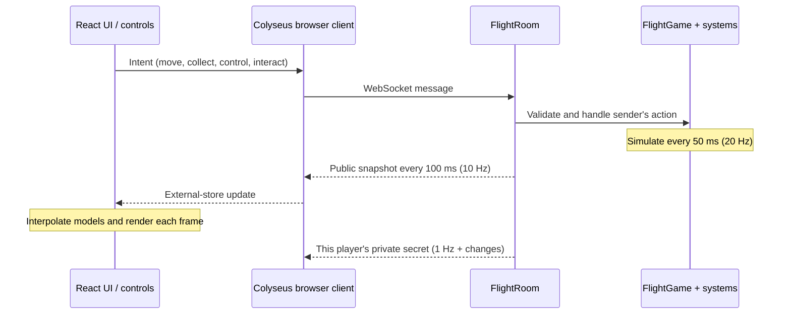
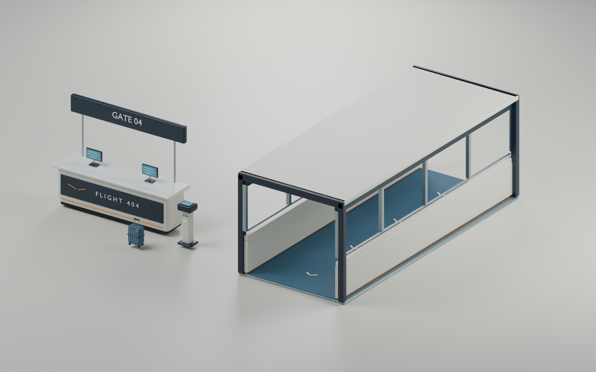

# FLIGHT 404

A multiplayer aircraft-crew social deduction game for desktop browsers. Meet at the terminal, collect flight documents, board through the jetbridge, prepare the cabin, take off, work through the flight, and land. One player has a hidden impostor allegiance and private tools for disrupting the journey.

**3–10 players · four-digit rooms · solo practice · keyboard and mouse**

## Run locally

Use Node.js **22+** and npm.

```sh
npm ci
npm run dev
```

Open [localhost:5173](http://localhost:5173). Vite serves the frontend on **5173**; the Colyseus server listens on **2567**. Keep both processes running. Choose **Solo practice** to learn every duty without an impostor, or create a flight and share its four-digit code. Each browser tab is a separate player; there are no accounts.

For a production-style local run:

```sh
npm run build
npm start
```

Open [localhost:2567](http://localhost:2567). The Node server serves `dist/` and the WebSocket endpoint together. `npm run preview` serves only the frontend and still needs a running game server.

## The complete journey

1. **Meet at Gate 04.** Players join the same terminal lobby, mark ready and wait for the host to start. The server assigns public jobs and exactly one secret impostor in multiplayer. Training has none. Rounds allow 12 minutes of active play; meeting time is separate.
2. **Collect documents.** Crew review a manifest, route briefing and duty assignment. Passengers review their boarding pass and baggage. Walk to the dispatch desk, review the document card and collect it. Each player's receipt is recorded by the server.
3. **Board.** Walk to the scanner and jetbridge, then scan the pass. The server verifies document collection and proximity before placing the player in the cabin. Other players see the same boarding roster. Authored travelers and luggage bring the gate to life.
4. **Prepare the cabin.** Complete the existing departure duties: safety presentation, passenger seating, trolley restraint and assigned station checks. The Captain starts takeoff from the flight deck once boarding and departure preparation are complete.
5. **Take off.** The Captain controls thrust, nose attitude, bank, brakes and landing gear. Other players watch the same server-owned aircraft. Build speed, raise the nose and establish the climb; the server decides when cruise has been reached.
6. **Work the flight.** Serve requests, complete the role-specific checks, respond to turbulence and pressure/smoke incidents, and watch other players' actions. Masks deploy when cabin pressure fails. Meetings pause the flight simulation and incident/device timers while players discuss and vote.
7. **Approach and land.** Finish the approach duties and resolve emergencies. The Captain begins the approach, manages speed and alignment, lowers the gear, touches down and brakes. A crew victory requires a completed landing; detaining the impostor does not teleport the aircraft to its destination.
8. **Debrief.** A successful flight ends on the runway. A detonated sabotage case or fatal pilot attack triggers a shared, non-graphic ocean-crash outcome. The exterior sequence shows the aircraft descending into the sea before the debrief.

Takeoff and landing are **arcade flight gameplay**, not real aircraft procedures or a certified flight simulation. The cabin stays in its own local coordinate space while the exterior presentation follows shared aircraft telemetry.

## Controls

| Input | Action |
| --- | --- |
| W / A / S / D | Walk in the terminal or cabin |
| Right-drag / arrow keys | Look around; cabin also supports pointer lock by clicking its view |
| E | Collect/scan at the gate or interact with the nearest eligible cabin duty |
| Hold E / hold an action button | Continue a physical cabin action until its progress completes |
| Tasks / Tab | Your public-role checks and the team's current duties |
| Cabin / M | Cabin layout |
| On board | Orders, passenger activities, incident response and private covert actions |
| G | Open service supplies, when your role can use them |
| Pilot thrust slider | Engine thrust during takeoff or landing |
| Pilot arrow buttons / arrow keys | Hold nose-up/down or bank input; release to neutralize |
| Gear / brakes buttons | Set landing gear and wheel brakes |
| Private kit / 1, 2, 3 | Impostor: equip knife, rope or sabotage case |
| Q | Impostor: conceal the equipped tool, or draw the knife |
| F | Impostor: use the equipped tool on a nearby target, or place the case |
| Hold security action button | Authorized crew: secure a suspicious case or release a restraint |
| Intercom / Report | Discuss observations and call a vote |
| Escape | Close panels and release the cabin pointer |

Focus loss, closing a control panel and loss of role authority release held controls. The server also expires stale movement and control inputs. Stay close to a station or person while holding a physical action.

## Roles, tasks and cabin life

Public roles and private allegiance are assigned independently. **Every player uses an ordinary traveler appearance**, so clothing does not reveal the impostor. Names and public duties remain visible; the private inventory does not appear in the shared snapshot. A tool becomes visible only when equipped.

| Public role | Three station checks | Other responsibilities |
| --- | --- | --- |
| Captain | Departure checklist, cruise instruments, landing configuration | Takeoff, turbulence control and landing |
| First Officer | Flight route, weather radar, arrival radio | Restore navigation and communications |
| Cabin Crew | Exit/aisle check, service preparation, seatbelt inspection | Safety presentation, deliveries, seating, trolley, first aid and mask assistance |
| Engineer | Circuits, pressure check, emergency equipment | Repair incidents, secure equipment and suspicious cases |
| Air Marshal | Manifest, flight-deck access, security sweep | Respond to exposed threats and cabin security incidents |
| Passenger | Carry-on stowage, safety card, seat preparation | Order four service items, read and rest |

The server enforces role ownership at action start **and completion**. The 18 checks use ordered checklists, route tracing, latches, packing, switches, matching and instrument dials. Matching/packing supports both drag-and-drop and card-then-slot selection. Training unlocks all duties. Multiplayer chapters require checks for the roles actually assigned in that room.

Three-player rooms have a Captain, Cabin Crew member and Engineer. Additional players add Marshal, First Officer, Passengers and further Cabin Crew. After a public role has no active operator for 20 seconds, reserve crew can cover its work. An idle or secretly hostile operator still owns the job: reserve coverage never identifies hidden allegiance.

**Safety demonstration:** at the front cabin station, arrange **seatbelt → oxygen mask → life vest → exits**. A correct solution starts a shared animated demonstration by the presenting player. The server times all four steps; the seatbelt explanation uses the supplied recording. The performance lasts 26.5 seconds and uses actual animated characters and Blender equipment props.

**Service:** collect water, coffee, a meal or a blanket from the aft galley and carry it to the matching passenger. Player orders appear in the crew's service panel. The AI attendant fetches and delivers NPC and player requests after a human priority period. A human delivery quota remains part of the flight story. Standing passengers walk back and sit after Cabin Crew guides them. The pilot, passengers and attendant are interactive NPCs.

**Incidents:** turbulence requires cockpit correction and a secure cabin. Pressure failure drops masks; players fit their own masks before assisting others or restoring the pressure system. Electrical smoke requires the Engineer. Crew can help an incapacitated player or treat a non-fatal pilot medical event. Solo practice includes optional incident drills.

## The hidden impostor

Exactly one multiplayer player receives the secret allegiance and private kit. Their normal appearance and public job remain unchanged. The kit contains **a knife, rope and one fictional sealed sabotage case**; the models contain no real weapon construction details.

- **Knife:** a visible, close-range attack. Existing server checks enforce range, sight, draw timing, cooldown, active status and phase. Pilot elimination causes an ocean-crash outcome.
- **Rope:** temporarily restrains a nearby player for 20 seconds. Restraints are shared, block the target's actions and permit a three-second Cabin Crew or Marshal rescue.
- **Sabotage case:** placing the case exposes a physical prop and countdown. The Engineer or Air Marshal can approach and hold for six seconds to secure it before its 60-second countdown expires. If both specialties are unavailable, reserve crew provide coverage after their absence grace period.
- **Aircraft disruptions:** power, intercom, navigation and oxygen-cut actions share authoritative cooldowns and incident rules. Existing covert tasks include incorrect service, fictional pilot drink tampering and damage at an equipment station.

These are bounded game actions: forged client messages cannot grant another player the kit, skip range checks or choose arbitrary damage. All attacks are non-graphic. Ordinary crew retain observation, reporting, voting, repair, rescue and disarm responses. A strict majority detains one player without publicly revealing their allegiance. A surviving threat cannot be identified from hidden fields because those fields are not broadcast.

## Technology stack

| Layer | Technology | Purpose |
| --- | --- | --- |
| UI | React 19, TypeScript | Menus, boarding documents, HUD, tasks and cockpit panels |
| Build/dev server | Vite 7 | Frontend development, asset URLs and production bundling |
| 3D | React Three Fiber 9, Three.js, Drei | Scene composition, WebGL rendering, GLB loading and camera rigs |
| Multiplayer | Colyseus 0.17, WebSockets | Room creation/joining, connections and real-time message transport |
| Backend | Node.js 22+, Express 4 | Authoritative game simulation, static serving and `/health` |
| Modeling | Blender, Python scripts, GLB/glTF | Original cabin, characters, equipment, terminal and props |
| Animation | Blender clips, Three.js AnimationMixer | Walking, sitting, serving, safety presentation and reactions |
| Audio | Web Audio API, supplied recordings | Engine/weather layers, cues and recorded announcements |
| Tests | Node test runner, tsx, real Colyseus SDK clients | Deterministic rules and live multi-client regression tests |
| Hosting | Static frontend + persistent WebSocket server | Current project uses Vercel and Render |

There is no external physics engine, database, paid asset-generation service, voice-chat service or runtime AI model. The attendant is a deterministic game simulation with routes, service claims and deliveries.

## How real-time multiplayer works



1. **Connection.** The browser resolves `VITE_SERVER_URL`, checks `/health`, and waits for a sleeping backend to wake before creating/joining a room. A successful join sends a sync request after handlers are attached.
2. **Room identity.** The server reserves an unused code from **1000–9999**. It releases the code when the room closes. Rooms accept up to ten players or one in training, and lock when the host starts.
3. **Inputs, not outcomes.** Clients submit direction, control axes and action intent. They never set position, completion, allegiance, remaining time, damage, touchdown or victory directly.
4. **Authority.** `FlightGame` checks phase, sender, role, availability, inventory, proximity, sight, token, cooldown and duration as appropriate. Cabin collision and maximum movement speed are enforced on the server. Task challenges are tied to the requesting player.
5. **Simulation.** A 50 ms room interval advances flight operations, movement, story, NPC service, incidents and held actions. Simulation deltas are clamped. Meetings pause simulation timers, including bombs, restraints and incidents; wall-clock action cooldowns continue. Continuous actions need fresh keepalive input and stop when their conditions fail.
6. **Replication.** This prototype broadcasts full plain-object `snapshot` messages every 100 ms. It deliberately disables automatic Colyseus schema patching; it does **not** use a `@colyseus/schema` state tree for these snapshots.
7. **Privacy.** Hidden allegiance, tool inventory and objective state stay in server-side private maps. `secret` messages go only to their owning connection, periodically and on relevant changes. Only equipped tools, planted cases, restraints and observable effects are public.
8. **Rendering.** A small session store notifies React through `useSyncExternalStore`. One persistent R3F Canvas switches keyed scene contents between intro, terminal, cabin and shared flight; it resets the camera lens when the view changes. Boarding receipts determine both the HUD and 3D scene. Gate desks/scanners load independently of background characters, with immediate signs and loading silhouettes. Terminal and cabin walking predict shared movement functions locally, then reconcile to the server. Exterior aircraft and runway motion interpolate the 10 Hz flight snapshots on every rendered frame, with a 100 ms presentation delay and at most 150 ms of prediction during packet gaps. The frame loop owns moving transforms, so React snapshots cannot reset the aircraft position. Meetings freeze the presentation clock; room/stage changes reset its sample track, and tab resume retains an interpolation anchor and caps clock advance. Each character effect owns a fresh animation mixer and actions, so React's development cleanup cycle cannot reuse disposed bindings. Dormant clips leave the mixer after fading out. Visual smoothing never completes an action or grants extra speed.
9. **Lifecycle.** Boarding receipts, manual takeoff, cruise readiness, landing and crash progression share the same authoritative operations state. UI dismissal cannot skip them. Restart clears round state and returns everyone to the terminal lobby.

Disconnecting immediately removes the seat and transfers host responsibility when needed. There is no durable reconnect recovery. The remaining public roles and reserve-crew rules handle absent operators; sessions are not restored after a server restart.

## Project structure

```text
client/src/
  App.tsx                 UI orchestration and scene routing
  network/                Colyseus connection + session store
  game/                   Input, audio and presentation helpers
  scene/                  R3F cabin, airport, aircraft, characters and effects
  ui/                     Boarding, cockpit, role tasks, service and security UI
shared/
  protocol.ts             Public/private message and state contracts
  world.ts                Layout, collision and interaction positions
  tasks.ts, duties.ts     Task catalog and role ownership
server/src/
  FlightRoom.ts           Connections, room lifecycle and simulation intervals
  systems/                Game rules, operations, flight, story, cabin and incidents
scripts/blender/          Reproducible original asset generators
models/blender/           Editable sources, manifests and inspection receipts
client/public/models/    Runtime GLBs, including journey/ airport and tool kit
voice/                    User-supplied source audio and cue instructions
tests/                    Unit and live multiplayer tests
docs/                     Assets, deployment and recorded verification
```

Simulation stays outside React. Aircraft dynamics are separate from cabin walking and NPC behavior, so future manual/autopilot blending can grow without moving every seat and player through world coordinates. Flight telemetry is intentionally simplified; full aerodynamic physics is not implemented.

## Blender assets and rebuilding

The active cabin and animated cast are authored in Blender. The new journey kit adds **11 original GLBs**: terminal, gate desk, jetbridge, scanner, crew documents, passport, suitcase, runway lights, sealed sabotage case, knife and rope. The kit is approximately **1.10 MB / 36,024 triangles**, with embedded materials and no external textures.



```sh
# If Blender is on PATH:
blender --background --python scripts/blender/build_journey_assets.py

# Standard macOS installation:
/Applications/Blender.app/Contents/MacOS/Blender --background --python scripts/blender/build_journey_assets.py

# Inspect runtime exports:
node scripts/inspect-glb.mjs client/public/models/journey/*.glb
```

The generator writes the journey asset source, exports and previews to the paths defined near the top of the script. Keep artist-supplied source models intact. Metric dimensions, pivots, materials, hashes and hand-mount offsets are documented in [the journey asset guide](models/blender/journey-assets.md). The editable source is `models/blender/journey-assets.blend`; the manifest and structural inspection report sit beside it. The three gallery previews are in `docs/previews/`.

The supplied Boeing remains the CC BY 4.0 exterior model by SAIMON584Models. Its verified landing-gear nodes are shown on the ground/approach and hidden in cruise; this is a gear-pose change, not a rigged mechanical retraction. See [asset provenance and licenses](docs/ASSETS.md) and the runtime attribution files for supplied assets.

## Audio

The installed recordings are `welcome.m4a`, `seatbelt.mp3` and `service chime.mp3`. Enable **Cabin sound** in the header. Captions remain available when muted or playback fails. Generated ambience covers engine, weather and pressure layers.

Add licensed `.mp3`, `.m4a`, `.ogg` or `.wav` files to `voice/`, then run:

```sh
npm run assets:voice
```

Development and production builds also prepare recordings automatically. See [voice/README.md](voice/README.md) for cue names and durations. Further useful recordings are terminal ambience, boarding scan, takeoff acceleration, gear movement, touchdown, braking and a non-graphic ocean-impact cue. Those extra sounds are not claimed as installed. Retain source URLs and licenses for downloaded recordings.

## Tests and verification

```sh
npm run typecheck
npm test
npm run test:ui
npm run build
```

With a separate game server running:

```sh
npm run test:integration
# Use an isolated test instance if needed:
COLYSEUS_URL=ws://localhost:2572 npm run test:integration
```

Integration tests create real WebSocket clients and temporary rooms. Do not run them against a populated production game: they deliberately move players, start rounds and exercise outcomes. Deterministic tests cover role assignment/privacy, permissions, collision, tasks, continuous actions, service, incidents, flight progression and security actions. The UI check renders markup in Node to verify boarding and pilot permissions; it does not launch a browser or validate WebGL. Recorded commands, results and browser limitations belong in [docs/TESTING.md](docs/TESTING.md); structural asset inspection and browser visual testing are separate checks.

## Deployment

The frontend needs a static host; the multiplayer server needs a **persistent Node process with WebSocket support**. For this project's existing setup:

| Service | Settings |
| --- | --- |
| Vercel frontend | Repository root; Node 22; install `npm ci`; build `npm run build`; output `dist` |
| Frontend environment | `VITE_SERVER_URL=wss://flight-404-server.onrender.com` before the build |
| Render backend | Node 22; build `npm ci --include=dev && npx tsc -p tsconfig.server.json`; start `npm start` |
| Backend environment | `CLIENT_ORIGIN=https://flyamoung-us.vercel.app`; platform-provided `PORT` |
| Backend health check | `/health` |

Deploy compatible frontend and backend commits together when changing the protocol. `VITE_SERVER_URL` is baked into the frontend at build time; changing runtime server variables will not rewrite an already-built client. Do not put secrets in `VITE_` variables. `CLIENT_ORIGIN` is an origin allowlist, not player authentication. Multiple allowed origins can be comma-separated. A `.env` example is included; the Node server reads process environment variables, not an automatically loaded root `.env` file.

For a single container:

```sh
docker build -t flight-404 .
docker run --rm -p 2567:2567 -e PORT=2567 flight-404
```

Terminate TLS at the host or reverse proxy and forward WebSocket upgrades. An HTTPS page needs WSS. For a separately hosted frontend, set `VITE_SERVER_URL` when building, including via the Docker build argument of the same name. Step-by-step setup and connection troubleshooting are in [docs/DEPLOYMENT.md](docs/DEPLOYMENT.md).

Start with **one server instance**. All rooms, secrets and room-code reservations live in process memory. A deploy or restart ends active rooms, and the free backend may sleep when idle. Multi-instance hosting requires a shared Colyseus presence/driver, atomic room-code allocation and routing to the process that owns each room. Static frontend hosting alone does not run the multiplayer backend.

## Current limits

This is a stylized desktop-first prototype, with no accounts, persistence, voice chat, durable reconnection, production matchmaking or mobile touch gameplay. The flight model is an arcade simulation; the sea-crash scene is a bounded visual outcome, not structural destruction or fluid physics. Existing animation clips are reused for tool holding and restraints. Terrain and ocean are presentation art rather than geographic data. Some furniture is decorative. A production competitive release still needs load testing, moderation, operational monitoring and a broader security review. Docker configuration is provided, but only claim a tested image build when it has actually been run.
